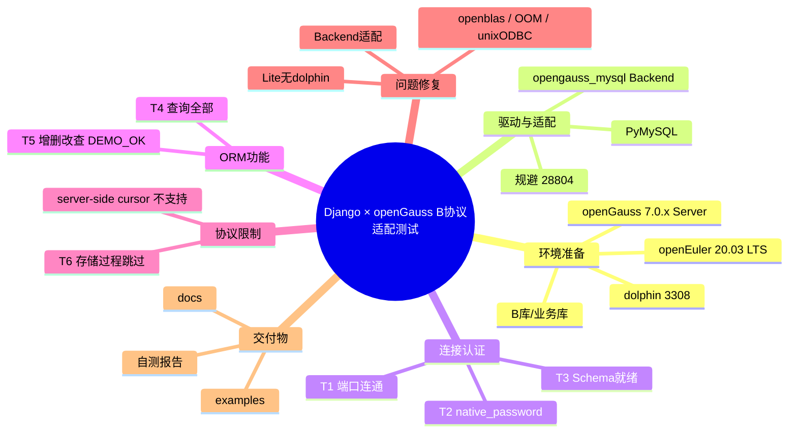

# Django × openGauss B 协议适配 — 测试思维导图

> 对应任务：`[开源实习]: openGauss B库B协议适配MySQL python orm框架 Django #34`  
> 可打开文件：同目录 [`测试思维导图.mm`](./测试思维导图.mm)（FreeMind / XMind 可导入）

## Mermaid 总览

## 用例映射

| 编号 | 分支 | 结果 |
|------|------|------|
| T1 | 连接认证 / 端口连通 | 通过 |
| T2 | 连接认证 / 握手认证 | 通过 |
| T3 | 连接认证 / Schema就绪 | 通过 |
| T4 | ORM功能 / 查询全部 | 通过 |
| T5 | ORM功能 / CRUD闭环 | 通过（`DEMO_OK`） |
| T6 | 协议限制 / 存储过程 | 跳过 |

## 使用说明

1. 用 [XMind](https://xmind.app/) / FreeMind / MindMaster 打开 `测试思维导图.mm`
2. 或在支持 Mermaid 的 Markdown 预览中查看上方导图
3. 详细步骤与日志见 [`自测报告.md`](./自测报告.md)
