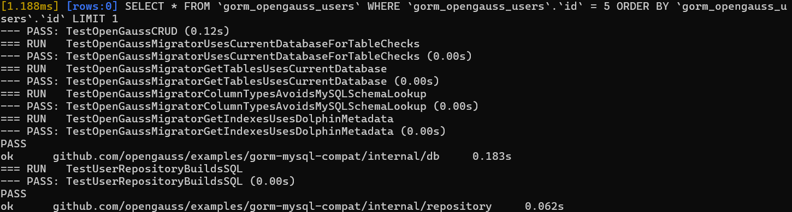

# 自测报告

## 环境与范围

代码按 openGauss 7.0.0-LTS B（dolphin）MySQL 协议设计，覆盖 GORM MySQL dialector 初始化、DSN 参数、连接健康检查、模型迁移和基本 CRUD。本地开发环境为 Go 1.23.10 windows/amd64；真实数据库联调由用户在 openEuler 20.03 LTS 虚拟机中的 openGauss 7.0.0-LTS 环境完成。

## 已实现与验证项

| 编号 | 用例 | 结果 |
|---|---|---|
| UT-01 | 默认主机/端口和 DSN 参数生成 | 已提供 internal/config/config_test.go |
| UT-02 | 非 MySQL 格式 DSN 拒绝 | 已提供 |
| UT-03 | sqlmock 上仓储 SQL 构建 | 已通过 |
| UT-04 | 迁移器 CurrentDatabase 使用 SELECT DATABASE()，不请求 SCHEMATA | 已通过 |
| UT-05 | 已存在表的 HasTable 检查使用真实数据库名 | 已通过 |
| UT-06 | GetTables 使用真实数据库名列举表 | 已通过 |
| UT-07 | ColumnTypes 使用 SELECT DATABASE() 获取数据库名，并显式查询列元数据 | 已通过 |
| UT-08 | GetIndexes 使用 Dolphin 小写 information_schema.statistics 并返回索引列 | 已通过 |
| IT-01 | openGauss B MySQL 协议连接与 Ping | 真实环境通过（migrate/CRUD 命令启动前均执行健康检查） |
| IT-02 | AutoMigrate 首次及重复执行 | 真实环境通过；重复迁移为 migration: OK，无 SCHEMATA/STATISTICS 错误及多余 MODIFY COLUMN |
| IT-03 | Create/Update/Read/Delete | 真实环境通过；创建 id=2，读回 Alice Updated、age=30，删除 rows=1 |

## 真实环境阶段性结果（2026-10-08）

用户报告 MySQL 客户端可连接至脱敏的虚拟机地址和 dolphin MySQL 协议端口。首次 migrate 虽创建表并输出 migration: OK，但元数据查询报错。第一轮修复使 CurrentDatabase 和 HasTable 正常使用 gorm_test；真实复测又发现 ColumnTypes 错误导致重复 ADD COLUMN（Error 28804）。随后 ColumnTypes 改为显式使用 SELECT DATABASE() 查询 Dolphin information_schema.columns。真实复测确认重复 ADD COLUMN 不再发生，且重复 AutoMigrate 不再执行 MODIFY COLUMN。之后发现 MySQL migrator 的 GetIndexes 访问 Dolphin 不支持的大写 INFORMATION_SCHEMA.STATISTICS 并触发 SCHEMATA 查询；现已增加 GetIndexes 覆盖，改用小写 information_schema.statistics 并显式指定当前数据库名。

2026-10-08 真实环境最终复测：用户确认再次执行 `go run ./cmd/gorm-opengauss -action=migrate` 输出 `migration: OK`，日志不再出现 SCHEMATA/STATISTICS 错误，也未产生不必要的 MODIFY COLUMN。随后 `go run ./cmd/gorm-opengauss -action=crud` 成功完成 AutoMigrate、INSERT（返回 id=2）、UPDATE（姓名改为 Alice Updated）、SELECT（读回 Alice Updated、age=30）和 DELETE（rows=1，输出 deleted）。真实环境的基础重复迁移和 CRUD 验证通过。脱敏 PowerShell 联调摘录及未记录环境项见 [真实环境联调证据](evidence/real_environment_smoke_test.md)。

本地回归验证：sqlmock 覆盖 CurrentDatabase、HasTable、GetTables、ColumnTypes 和 GetIndexes；Go 单元测试 `go test ./...` 与静态检查 `go vet ./...` 均通过。

如需在另一套目标环境复测，在 MySQL 客户端登录相同数据库后，可先用 `SELECT DATABASE();` 确认当前数据库名，再在 PowerShell 工程目录中执行：

    go run ./cmd/gorm-opengauss -action=migrate

预期结果是 `migration: OK`，且不出现 `Information_schema.SCHEMATA` / `INFORMATION_SCHEMA.STATISTICS` 查询错误或重复 DDL。随后运行 `go run ./cmd/gorm-opengauss -action=crud` 验证基本 CRUD。

集成测试代码位于 internal/db/opengauss_integration_test.go，目标环境可执行：

    go test -tags=integration ./internal/db

运行前请在当前 PowerShell 会话安全设置 OPENGAUSS_DSN 环境变量；不要把含口令的连接串写进命令历史或提交文件。

## 兼容性风险与处理

MySQL 方言的版本探测可能无法解析 openGauss 版本号，已设置 SkipInitializeWithVersion。索引/列重命名、日期时间精度等 DDL 依赖 dolphin 兼容实现，示例关闭对应能力并建议在目标版本单独验证。

## 目标环境执行清单

1. 配置 dolphin 插件和 MySQL 协议端口，创建测试库及最小权限用户。
2. 安装 Go 1.20+，执行 go mod tidy && go test ./...。
3. 设置 OPENGAUSS_DSN，依次运行 health、migrate、crud。
4. 如在其他版本、架构或系统复测，保存命令输出、GORM SQL 日志和 openGauss 服务端日志作为测试附件；当前真实联调使用 Windows/amd64 Go 客户端连接用户的 openEuler 20.03 LTS 虚拟机，服务器 CPU 架构未记录，因此不声明 aarch64 已通过。

## PowerShell 历史命令审计记录（2026-11-28）

### 记录来源与限制

本节根据本机 PSReadLine 历史文件中与本示例相关的命令整理。PowerShell 历史文件只保存命令文本，不保存命令的标准输出、错误输出和退出码；因此本节证明“命令已在该 PowerShell 会话中执行过”，不把命令记录本身当作测试通过证据。health、migrate、crud 和集成测试的最终通过状态，应以同一会话中保存的终端输出或截图为准。

历史中的密码、完整 DSN、用户目录和虚拟机地址均不在本报告中重复。报告使用 `<VM_IP>` 表示虚拟机地址，使用 `<REDACTED>` 表示认证信息。

### 从历史中确认的执行动作

| 类别 | 历史命令或动作 | 审计结论 |
|---|---|---|
| 网络连通性 | `Test-NetConnection <VM_IP> -Port 3308` | 已执行；历史不保存 `TcpTestSucceeded` 输出 |
| MySQL 客户端 | 设置 MySQL 客户端目录、执行 `mysql --version`，并连接 `<VM_IP>:3308` | 已执行；历史不保存登录结果 |
| Go 单元测试 | `go test ./...` | 已执行；历史不保存退出码 |
| GORM 健康检查 | `go run ./cmd/gorm-opengauss -action=health` | 已执行多次；历史不保存输出 |
| GORM 迁移 | `go run ./cmd/gorm-opengauss -action=migrate` | 已执行多次；历史不保存输出 |
| GORM CRUD | `go run ./cmd/gorm-opengauss -action=crud` | 已执行多次；历史不保存输出 |
| 集成测试 | `go test -tags=integration ./... -v` | 已执行；历史不保存是否跳过或通过 |

### 最后一次可识别的连接参数

历史中最后一次明确设置了以下非敏感参数：

```text
OPENGAUSS_HOST=<VM_IP>
OPENGAUSS_PORT=3308
OPENGAUSS_USER=proto_test
OPENGAUSS_DATABASE=gorm_test
```

历史较早的命令曾把物理数据库名 `proto_test_db` 写入 DSN，后续才改为 `gorm_test`。本示例约定 `OPENGAUSS_DATABASE` 填写目标 schema；物理 B 兼容库由服务端 Dolphin 配置选择。复测时应确认 PowerShell 中 `$env:OPENGAUSS_DATABASE` 输出为 `gorm_test`。

### 安全处理建议

历史中曾出现带明文认证信息的 DSN 命令。该凭据已经进入 PowerShell 历史文件，建议立即修改 `proto_test` 密码，并清理历史中的敏感命令；后续使用分项环境变量并在测试结束后删除 `OPENGAUSS_PASSWORD`，不要把完整 DSN 或密码提交到仓库、截图或 PR 评论。

### 可复核命令（不包含密码）

在示例模块目录中执行：

```powershell
Test-NetConnection <VM_IP> -Port 3308
go test ./...
go run ./cmd/gorm-opengauss -action=health
go run ./cmd/gorm-opengauss -action=migrate
go run ./cmd/gorm-opengauss -action=migrate
go run ./cmd/gorm-opengauss -action=crud
go test -count=1 -tags=integration ./... -v
```

其中两次 `migrate` 用于验证重复迁移不会产生重复列或重复 DDL；`-count=1` 用于禁用 Go 测试缓存，确保集成测试重新访问真实数据库；`integration` 测试必须确认输出中没有 `SKIP`，才能计为真实集成测试通过。

### 真实集成测试成功截图

下图来自真实 openGauss 环境执行 `go test -tags=integration ./... -v` 的 PowerShell 输出。截图显示 `TestOpenGaussCRUD`、迁移器适配测试和仓储测试均为 `PASS`，并且最终两个 Go 包均返回 `ok`。



该截图可以证明测试命令的最终结果，但没有包含连接参数、服务端版本、端口监听状态和完整命令行。因此建议同时保存网络、服务端和应用级证据，形成可复核链路。
